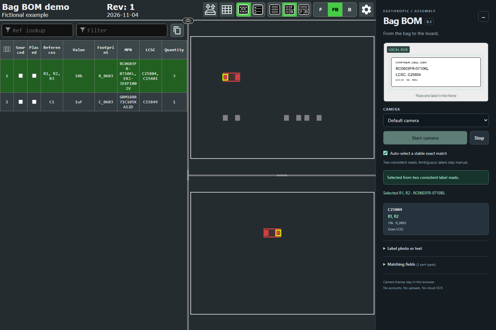

# Bag BOM

**Show the bag. Find the part.** Offline webcam label scanning for
[InteractiveHtmlBom](https://github.com/openscopeproject/InteractiveHtmlBom).

[](LICENSE)
[](https://github.com/egethropic/bag-bom/actions/workflows/test.yml)

Bag BOM is a KiCad companion plugin from **egethropic**. Hold a component bag's
printed MPN or supplier part number in front of your webcam. Two consistent,
confident reads select the matching components and highlight their placements
in your InteractiveHtmlBom viewer, including parts on both sides of the board.



**Experimental v0.1.0.** Tested with synthetic labels through real Tesseract OCR
and a simulated camera. Physical webcams, glare, crumpled bags, small labels,
and your actual parts still need bench validation. Check the highlighted part
before soldering. Bag BOM selects parts; it never marks them as placed.

## Install

1. Install [InteractiveHtmlBom](https://github.com/openscopeproject/InteractiveHtmlBom/wiki/Installation)
   separately in KiCad.
2. Download `bag-bom-0.1.0-pcm.zip` from
   [Releases](https://github.com/egethropic/bag-bom/releases).
3. In KiCad's **Plugin and Content Manager → Install from File**, select that ZIP.
4. Restart the PCB Editor or refresh its action plugins.
5. Choose **Tools → External Plugins → Bag BOM — scan component labels**.

No Node.js, pip packages, OCR installation, cloud account, or API key is needed
to use a release. OCR assets and English recognition data are bundled.
This initial package uses KiCad's SWIG action-plugin runtime (KiCad 9–10).
KiCad 10.0.8 on Windows is the locally checked Python runtime. Linux/macOS and
KiCad 9 are intended targets, not yet manually verified. KiCad 11+ IPC support
is not included. This project is not yet in KiCad's official plugin catalog.

Manual alternative: extract `bag-bom-0.1.0-manual.zip` so the `bag_bom` folder
sits inside your KiCad user scripting plugins directory. Avoid installing both
the manual and PCM copies.

## Prepare and scan

1. In your schematic, add an exact **MPN** and/or supplier field such as **LCSC**,
   **Digi-Key Part Number**, or **Mouser Part Number**; update the board from the
   schematic as appropriate.
2. Generate an InteractiveHtmlBom export with those fields included in its
   visible/exported fields. Grouping by MPN is recommended. Bag BOM can still
   distinguish different MPNs inside a single value/footprint group.
3. Launch Bag BOM and choose that `ibom.html`. It opens in your default browser.
4. Select your webcam, click **Start camera**, and allow the browser's camera
   permission. Keep one label, in focus and upright, inside the green guide.
5. A unique exact match in two consecutive reads (OCR confidence ≥75) selects
   its footprints automatically. Disable **Auto-select** to choose manually.

The scanner highlights matching **footprint IDs**, never substring search
results. It switches the viewer to the relevant side(s) and clears BOM filters
so the selected part can be seen. With different identities in one upstream BOM
row, the row still displays its original references, but only the matching
footprints are highlighted. All selected references are listed in the scanner.

If a label contains more than one matching identity, choose from the candidates.
Similar OCR strings are suggestions only; `O`/`0` substitutions and missing
suffixes never trigger automatic selection. Value/package-only labels, barcode
images, unknown supplier SKUs, and partial part numbers are not auto-identified.
Supplier SKUs must already be present in your exported BOM; there is no online
part database lookup. You can enable other identifier columns under
**Matching fields**. Very short IDs (under 4 characters) and identifiers without
digits are excluded from automatic matching in this version.

**Label photo or text** accepts a saved image, pasted text, or a USB barcode
scanner acting as a keyboard. Press Enter to match text, then click the result.
Image/text results require a click; two-frame auto-selection is for live video.
Stop, minimize, or switch away from the tab to release the camera. A failed
match leaves the previous highlight in place; check the status and selected
reference list before proceeding.

## Privacy and session behavior

The plugin serves the chosen HTML and bundled OCR assets on `127.0.0.1` using a
random port and unguessable session path. It never serves a project directory.
The source HTML, schematic, and PCB are not modified. Camera frames stay in the
browser; Bag BOM has no upload endpoint, analytics, cloud OCR, or runtime CDN
dependency. Open only HTML exports you trust: they contain executable JavaScript.

Keep KiCad running while the viewer is open. The local server exits after three
minutes without a browser heartbeat. Each launch uses a fresh browser origin:
**export/import InteractiveHtmlBom settings to preserve assembly checkbox progress
across Bag BOM sessions**. Existing progress in a separately opened `file://` BOM
does not automatically transfer. Within one open session, normal iBOM checkboxes
and selection remain available. Bag BOM itself never checks a placement box.

Chrome/Edge are the tested browser family. Firefox/Safari camera and WebAssembly
behavior has not been validated. If the camera cannot start, check browser
permissions, close other apps using it, or use image/text input. For blurry labels,
use even lighting, reduce reflections, and move the label within the camera's
focus range.

## Run without KiCad

Extract the manual ZIP, then from its parent directory:

```sh
python -m bag_bom /path/to/ibom.html
```

Requires Python 3.9+ and a modern browser. A generated demonstration HTML and
synthetic label image are provided as release assets. They contain no user board
data. Camera auto-selection can be tried by displaying or printing the label.

## Develop and test

```sh
npm ci
npm run vendor
python -m pip install -r requirements-dev.txt
python scripts/make_fixture.py
npm test
python -m unittest discover -s tests -p "test_*.py"
npx playwright install chromium
npm run test:browser
npm run build
python scripts/smoke_package.py
```

The fixture script downloads the unmodified InteractiveHtmlBom viewer at commit
`d1eb5b79a52a2ddc1ce270b63920346463c19b05` (2.12.0 development line). Pass a local
upstream checkout as its optional argument to avoid the download. The tests use
a fictional board, an intentionally mixed BOM group, front/back placements, and
a synthetic label. Browser tests exercise real OCR for both an image and a fake
webcam, ambiguity, exact selection, camera denial, stop/minimize, and layout.
The Python tests check the loopback server's file boundary, host/origin checks,
and source preservation. There is no KiCad or hardware dependency for these tests.

`scripts/package.py` creates deterministic PCM and manual ZIPs plus checksums.
The source checkout omits generated OCR binaries; `npm run vendor` copies them
from packages pinned in `package-lock.json`. Keep Apache-2.0 and third-party
notices in every distribution. Upstream's internal highlighting functions are
checked at startup, but future iBOM versions may require adapter updates.

## License and credits

Copyright 2026 egethropic. **[Apache License 2.0](LICENSE)**.

Thanks to [InteractiveHtmlBom](https://github.com/openscopeproject/InteractiveHtmlBom)
(MIT), [Tesseract.js](https://github.com/naptha/tesseract.js) (Apache-2.0), and
Tesseract/Leptonica. See [NOTICE](NOTICE) and
[THIRD_PARTY_NOTICES.md](THIRD_PARTY_NOTICES.md).
This is an independent project, not an official KiCad or InteractiveHtmlBom release.
